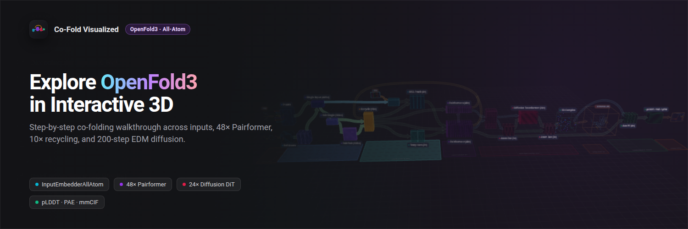
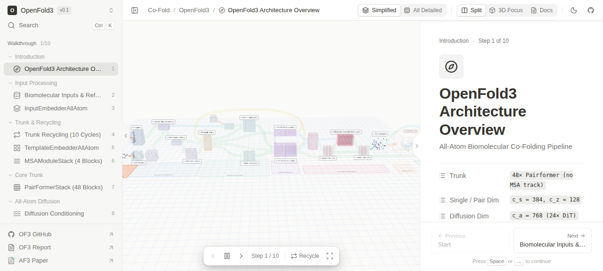

<p align="center">
  
</p>

<h1 align="center">Co-Fold Visualized</h1>

<p align="center">
  An interactive 3D walkthrough of the <strong>OpenFold3</strong> co-folding architecture.
</p>

<p align="center">
  <a href="https://select.github.io/cofold-visualizer/"><strong>Live Demo (GitHub Pages)</strong></a> ·
  <a href="https://github.com/aqlaboratory/openfold-3"><strong>OpenFold3 Repo</strong></a> ·
  <a href="https://portal.openfold.omsf.io/reports/of3p2_technical_report.pdf"><strong>OF3 Report</strong></a> ·
  <a href="#contributing"><strong>Contributing</strong></a>
</p>

<p align="center">
  <a href="https://select.github.io/cofold-visualizer/"><code>https://select.github.io/cofold-visualizer/</code></a>
</p>

---

## Overview

**Co-Fold Visualized** turns the all-atom OpenFold3 architecture into an interactive 3D pipeline synchronized with a step-by-step technical inspector. Explore how protein, RNA, DNA, and small-molecule ligand inputs flow through `InputEmbedderAllAtom`, 10× trunk recycling, the 48-block `PairFormerStack`, 200-step all-atom EDM diffusion, and confidence prediction heads.

<p align="center">
  
</p>

## Features

- **Interactive 3D Architecture Viewport** — Orbit, pan, and cursor-centered zoom across the full OpenFold3 pipeline built with Three.js.
- **10-Step Guided Walkthrough** — Step through inputs, `InputEmbedderAllAtom`, 10× recycling, `TemplateEmbedderAllAtom`, `MSAModuleStack`, `PairFormerStack (48×)`, diffusion conditioning, 200-step EDM diffusion, and confidence heads (`pLDDT`, `PAE`, `pTM`).
- **Simplified & Detailed Internals** — Inspect high-level blocks or expand individual modules in place to see internal layers, tensor shapes, and attention heads.
- **Input & Output Inspectors** — Browse example FASTA/MSA/SMILES inputs and `.cif` 3D ribbon previews alongside confidence metrics.
- **Fast Navigation** — Split, 3D Focus, and Docs view modes, `Ctrl+K` / `Cmd+K` command palette, and Light/Dark theme support.

## Getting Started

### Prerequisites

- **Node.js** `>= 22` (tested with Node 24)
- **pnpm** `>= 10`

### Local Development

```bash
git clone https://github.com/select/cofold-visualizer.git
cd cofold-visualizer
pnpm install
pnpm dev
```

Open [http://localhost:3000](http://localhost:3000) in your browser.

### Scripts

| Command             | Description                             |
| ------------------- | --------------------------------------- |
| `pnpm dev`          | Start the Nuxt development server       |
| `pnpm generate`     | Build static output to `.output/public` |
| `pnpm test:run`     | Run Vitest unit tests                   |
| `pnpm lint`         | Run `oxlint` and `eslint`               |
| `pnpm format:check` | Check formatting with `oxfmt`           |
| `pnpm typecheck`    | Run `nuxt typecheck`                    |

## Tech Stack

- **Framework:** [Nuxt 4](https://nuxt.com/) · [Vue 3](https://vuejs.org/) · [Pinia](https://pinia.vuejs.org/)
- **3D Engine:** [Three.js](https://threejs.org/)
- **Styling & Icons:** [UnoCSS](https://unocss.dev/) · Iconify (`lucide`, `mdi`)
- **Testing & Tooling:** [Vitest](https://vitest.dev/) · `oxlint` · `eslint` · `oxfmt` · `commitlint`

## Contributing

Contributions are warmly welcomed! Whether it's improving 3D module details, adding support for additional co-folding models (such as Boltz or Chai-1), refining documentation, or fixing bugs:

1. **Fork** the repository and create a feature branch:
   ```bash
   git checkout -b feat/my-improvement
   ```
2. **Make your changes** and verify tests and linting pass:
   ```bash
   pnpm test:run
   pnpm lint
   pnpm format:check
   ```
3. **Commit** using [Conventional Commits](https://www.conventionalcommits.org/) (enforced by `commitlint`):
   ```bash
   git commit -m "feat(3d): describe your change"
   ```
4. **Open a Pull Request** against `main` with a clear description (and screenshots if changing visuals).

## Inspiration & References

- Inspired by [bbycroft/llm-viz](https://github.com/bbycroft/llm-viz) — interactive 3D LLM architecture visualizer
- [OpenFold3 GitHub Repository](https://github.com/aqlaboratory/openfold-3)
- [OpenFold3 Technical Report](https://portal.openfold.omsf.io/reports/of3p2_technical_report.pdf)
- [AlphaFold 3 Paper (Nature, 2024)](https://www.nature.com/articles/s41586-024-07487-w)
